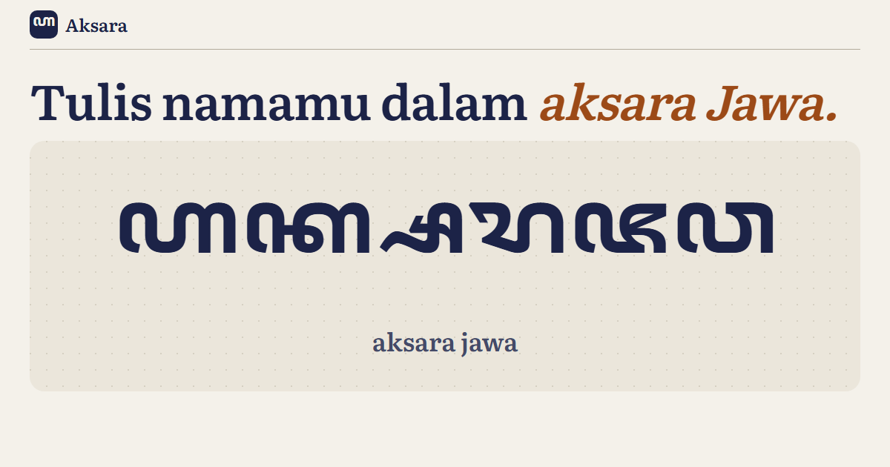

# Aksara



**[Buka Aksara](https://aksara-id.vercel.app)**

Alih aksara Latin ⇄ aksara Jawa (hanacaraka), dengan penjelasan kenapa setiap suku ditulis
begitu.

- **Latin ke Jawa** secara langsung, dengan rincian per suku kata: misalnya `ꦏꦂ` = ka +
  layar (r mati), atau `ꦏ꧀ꦱ` = k mati + pasangan sa. Hasil bisa disalin sebagai teks Unicode
  atau diunduh sebagai gambar 1200×630.
- Pilihan bacaan huruf e (ê pepet atau é taling) dan penulisan dengan atau tanpa spasi
  (tradisional).
- **Jawa ke Latin**: tempel teks beraksara Jawa untuk dibaca.
- **Carakan** dua puluh aksara beserta pasangannya, disusun menurut empat baris kisah Aji
  Saka, dan contoh semua sandhangan pada aksara ka.
- **Kuis** membaca suku kata dengan rekor tersimpan di peramban.
- Teks yang diketik tersimpan di tautan, jadi bisa dibagikan.

## Kaidah

| Bunyi | Ditulis dengan |
|---|---|
| vokal i, u, é, o, ê | wulu, suku, taling, taling tarung, pepet |
| h, r, ng mati | wignyan, layar, cecak |
| konsonan mati lain sebelum konsonan | pasangan (konsonan + pangkon + konsonan) |
| konsonan mati di akhir | pangkon |
| konsonan + r, konsonan + rê | cakra, keret |
| konsonan + y | pengkal |
| rê, lê | pa cêrêk, nga lêlêt |
| vokal di awal kata | ha |
| f, v, z, kh | aksara rekan dengan cecak telu |

Bentuk pasangan digambar oleh fon Noto Sans Javanese dari urutan Unicode, jadi hasilnya bisa
dipakai di aplikasi lain yang mendukung aksara Jawa. Semua kode Unicode diperiksa terhadap
basis data Unicode, dan kaidah di atas diuji (`npm test`) dengan ejaan baku seperti
ꦔꦪꦺꦴꦒꦾꦏꦂꦠ (Ngayogyakarta), ꦱꦸꦫꦏꦂꦠ (Surakarta), dan ꦗꦮꦠꦼꦔꦃ (Jawa Têngah).

Belum didukung: aksara murda, aksara swara, aksara rekan lain, dan ejaan khusus yang tidak
mengikuti bunyi. Pembacaan balik sederhana: ha di awal kata dibaca sebagai vokal dan spasi
tidak dikembalikan.

## Menjalankan

```
npm install
npm run dev
npm test
npm run build
```

Vite + TypeScript, tanpa framework. Huruf: Noto Sans Javanese (SIL OFL), Literata, Work Sans.
